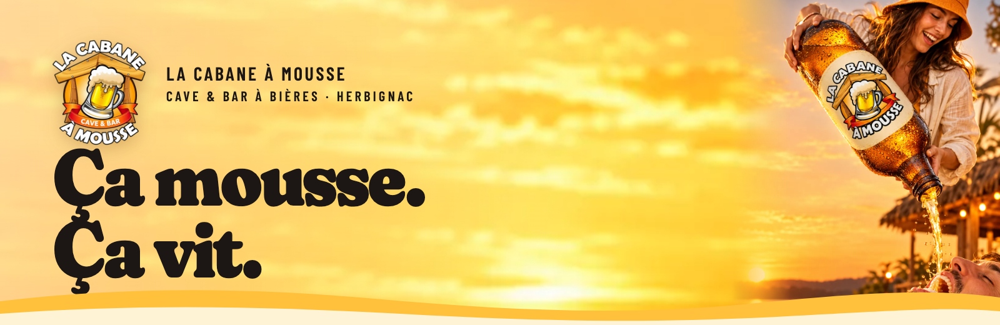
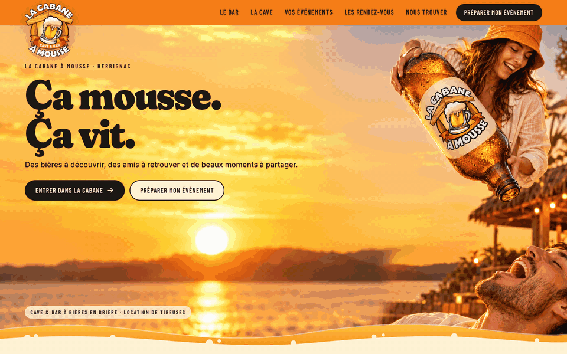
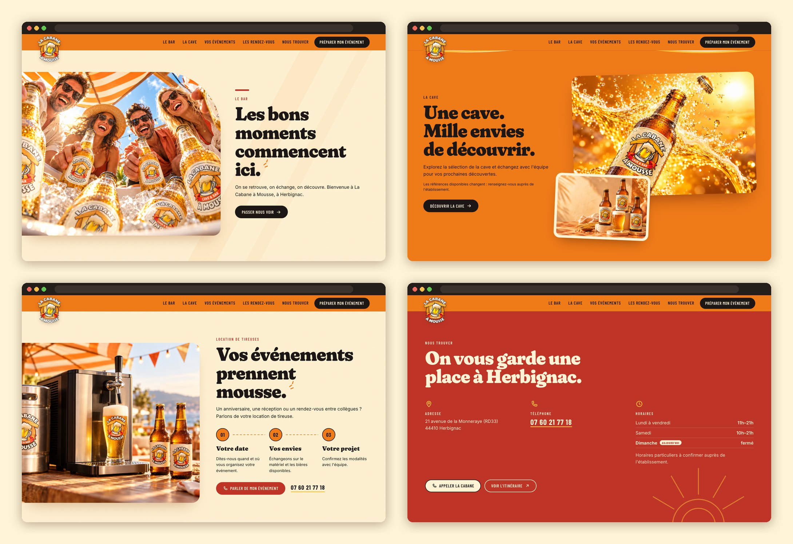
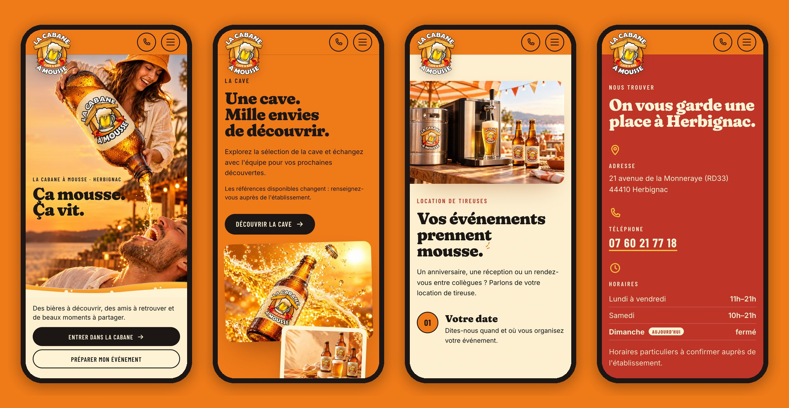
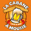

<div align="center">



<h3>A one-page website for a beer cellar & bar in Herbignac, built around a scroll-driven pour from one friend to another.</h3>

<p>
  <a href="https://la-cabane-a-mousse-herbignac.vercel.app"><strong>🌐 Live site</strong></a>
  &nbsp;·&nbsp;
  <a href="#hero-animation"><strong>🎬 How the hero works</strong></a>
  &nbsp;·&nbsp;
  <a href="#getting-started"><strong>🛠️ Run it locally</strong></a>
</p>

<p>
  <a href="https://la-cabane-a-mousse-herbignac.vercel.app"></a>
  
  
  
  
</p>

</div>

<br />

## 🚀 Overview

**La Cabane à Mousse** is a cave & bar à bières in Herbignac, in the Brière, that also hires out beer taps for events. The site is built on one image from the creative brief: a woman tips a giant bottle wearing the Cabane's label, and a friend below catches the stream, mouth wide open. As you scroll, **the beer leaves the bottle and falls into his mouth**, then the page opens onto friends, the cellar and the events.

Everything else follows the logo's colours (honey, orange, banner red, foam and ink) and leads to two actions: **call the Cabane** or **plan an event**.

- **A first impression that moves**: a photographic 2D reveal driven by the scroll, not a video
- **Clear path to contact**: every section ends on the phone number, the tap-hire steps or the directions
- **Built for every visitor**: no-JS and reduced-motion visitors get the finished photo, full keyboard support, visible focus, French copy as real text
- **Light**: about 420 KB on a phone's first load, fonts included

<br />

<a name="hero-animation"></a>

## 🎬 The hero animation

<div align="center">
  <a href="https://la-cabane-a-mousse-herbignac.vercel.app"></a>
  <sub>Scroll-scrubbed on the live site · captured at 1440 × 900</sub>
</div>

<br />

On desktop the hero stays pinned for about 1.2 screen heights (0.7 on phones) and follows the brief's motion script:

| Scroll  | What happens                                                                                       |
| :------ | :------------------------------------------------------------------------------------------------- |
| 0–15%   | The scene before the pour: both people, the headline and the two calls to action                   |
| 15–25%  | The camera pushes in by 2.5%; nobody's arms move                                                   |
| 25–60%  | The beer falls from the bottle neck to the open mouth, with a faint glint riding the stream        |
| 60–75%  | Contact: a 550 ms crossfade to the finished photo and a short splash of light at the mouth          |
| 75–90%  | Warm sunlight settles over the photo                                                               |
| 90–100% | The scene releases and **Le bar** scrolls in                                                       |

**Under the hood**

- 🧩 **A registered before/after pair.** The kit ships the scene without the stream and the finished photo on the same 1024 × 1536 canvas. `scripts/measure-scene.py` cuts the stream out of their pixel difference (a 344 × 720 RGBA layer) and finds the neck exit, so the reveal starts exactly at the bottle.
- 📐 **Never cropped.** The scene is always shown whole at full height, so neither person is ever cut. On wide screens the sky, sun and sea of the approved 3:2 hero fill the left side, mapped by matching both horizons; the seam is feathered by a mask kept clear of the people and colour-matched by a measured gradient layer.
- 🧮 **Measured, not guessed.** Every coordinate the animation reads (stream box, reveal span, horizons, timeline) lives in `src/data/scene.json`, generated with verification overlays.
- 🐢 **Graceful by default.** With `prefers-reduced-motion`, without JavaScript, or if the script hasn't started after 4 s, the page shows the finished photo and nothing is pinned. `?p=0.4` freezes the scene for captures and `?nosmooth` turns off the easing.

<br />

## 🖥️ Sections

<div align="center">
  
</div>

<br />

| #   | Section                                   | Anchor          | Role                                                                          |
| :-- | :---------------------------------------- | :-------------- | :---------------------------------------------------------------------------- |
| 01  | **Ça mousse. Ça vit.**                    | `#top`          | The pour, the promise and both calls to action                                |
| 02  | **Les bons moments commencent ici.**      | `#bar`          | Friends in a big window on foam, red detail, invitation to drop by            |
| 03  | **Une cave. Mille envies de découvrir.**  | `#cave`         | Orange chapter with the labelled campaign bottles; no stock or prices         |
| 04  | **Vos événements prennent mousse.**       | `#evenements`   | Tap hire in three steps and a direct phone call; conditions confirmed by phone |
| 05  | **La vie de la Cabane.**                  | `#rendez-vous`  | Points to Instagram until a curated agenda exists                             |
| 06  | **On vous garde une place à Herbignac.**  | `#nous-trouver` | Address, phone, opening hours with today highlighted, directions              |
| 07  | Footer                                    | n/a             | Details, site map and the French health warning                               |

<br />

## 📱 Mobile first, motion optional

<div align="center">
  
</div>

<br />

- The whole scene stays in frame, the headline sits beside the stream and the calls to action live in a foam band below it
- Header with the logo, a call button and a full-screen menu (Escape closes it)
- Every touch target is at least 44 px; no horizontal scroll at 360 or 390 px
- Nothing depends on hover

<br />

## ✨ Highlights

- **🍺 Scroll storytelling**: a small `requestAnimationFrame` engine maps scroll progress to the brief's timeline, using only transforms, opacity and masks
- **📞 Contact without a form**: the brief allows no fake submission, so every action is a real `tel:` link or the directions
- **🕘 Today's hours**: opening hours are rendered into the HTML at build time; a few lines of JS only highlight today's row (Paris time)
- **♿ Accessible components**: skip link, labelled menu button with `aria-expanded`, a described hero image, honey never used as small text on cream
- **🖼️ Image pipeline**: the kit's PNG masters stay untouched; `npm run images` writes versioned AVIF/WebP sizes, icons and the share image
- **🔤 Lean type**: Fraunces is pinned to the one style the site uses (Black, soft) with its optical-size axis kept: 121 KB → 29 KB
- **🔎 Ready to share**: Open Graph image, `BarOrPub` structured data with opening hours, favicons (kept `noindex` until launch)

<br />

## 💻 Tech stack

| <br />Vite 6 | <br />JavaScript | <br />HTML5 | <br />CSS3 | <br />OpenCV | <br />Vercel |
| :---: | :---: | :---: | :---: | :---: | :---: |

### Why this stack?

- **Vite + plain JavaScript**: a one-page site doesn't need a framework runtime; the page is static HTML with three small modules (5.7 KB of JS)
- **Own scroll engine**: one pinned scene with a handful of properties; a few lines of `requestAnimationFrame` replace a scroll library
- **Python + OpenCV for measurement**: the reveal is driven by numbers measured from the kit's images, not by hand-placed guesses
- **Self-hosted Fraunces, Barlow Condensed and Inter**: expressive display type without third-party font requests
- **Vercel**: every push to `main` deploys automatically

<br />

## 🎨 Design system

| Token  | Value                                                                        | Use                                              |
| :----- | :--------------------------------------------------------------------------- | :----------------------------------------------- |
| Honey  |  | News band, accents, underlines (never small text on cream) |
| Orange |  | Header, cellar chapter, step numbers             |
| Red    |  | Contact block, tap-hire button, eyebrows         |
| Foam   |  | Page background, text on red and ink             |
| Ink    |  | Text, primary buttons, footer                    |

- **Palette**: only the logo's colours; no green anywhere, as the brief asks
- **Type**: Fraunces Black (soft) for headlines, 36–142 px in the hero and 40–76 px for sections; Barlow Condensed for labels and buttons; Inter for body text at 16–18.5 px
- **Shapes**: beer waves with foam bubbles and torn-paper edges between chapters, a line-drawn sun, rounded photo windows
- **Motion**: entrances of 26–40 px over 700–900 ms with a light stagger; a slow parallax on the cellar photos; all off with reduced motion

<br />

<a name="getting-started"></a>

## 🛠️ Getting started

```bash
# Clone the repository
git clone https://github.com/Jeanfr1/la-cabane-a-moussewebsite.git
cd la-cabane-a-moussewebsite

# Install dependencies (Node 20.9+)
npm install

# Start the dev server  →  http://localhost:5188
npm run dev

# Production build  →  dist/
npm run build

# Preview the production build  →  http://localhost:4188
npm run preview

# Re-measure the scene (Python 3 with OpenCV) and regenerate the images
npm run measure
npm run images

# Re-instance the display font (Python 3 with fonttools + brotli)
npm run fonts
```

<br />

## 📁 Project structure

```
la-cabane-a-moussewebsite/
├── index.html                  # Every section: hero → bar → cave → événements → rendez-vous → nous trouver → footer
├── vite.config.js              # Renders facts, <x-pic> pictures and scene variables into the HTML at build time
├── src/
│   ├── main.js                 # Entry: fonts, styles, module init
│   ├── data/
│   │   ├── site.js             # Name, phone, address, hours, links, structured data (single source)
│   │   ├── scene.json          # Measured scene geometry and timeline (generated)
│   │   └── images.json         # Image manifest (generated)
│   ├── styles/                 # base.css (tokens, header) · hero.css · sections.css
│   └── js/
│       ├── hero.js             # Scroll progress → pour reveal, contact, sun; sky mapping
│       ├── reveal.js           # Entrance animations and cellar parallax
│       └── nav.js              # Mobile menu, compact logo, today's hours
├── scripts/
│   ├── measure-scene.py        # Stream cut-out, feather mask, colour bridge, sky crop, scene.json
│   ├── build-images.mjs        # PNG masters → AVIF/WebP, icons, share image (sharp)
│   └── subset-fonts.py         # Fraunces instance + subset
├── public/                     # Generated images, font, favicons, Open Graph image
├── assets-src/                 # Layers derived by measure-scene.py
└── 01-identidade … 08-estudo/  # The creative kit (brief, mockups, masters, scripts), kept as delivered
```

<br />

## 🚀 Deployment

Hosted on **Vercel** and connected to this repository: every push to `main` ships to production.

**Live site:** [la-cabane-a-mousse-herbignac.vercel.app](https://la-cabane-a-mousse-herbignac.vercel.app)

| Setting          | Value           |
| :--------------- | :-------------- |
| Framework        | Vite            |
| Build command    | `npm run build` |
| Output directory | `dist`          |

The creative kit folders are excluded from the deployment by `.vercelignore`.

<br />

## 📌 Content checklist

Items waiting on the owner. Each one is marked `TODO(cabane)` in `index.html` or `src/data/site.js`.

- [ ] Approved photos of the bar, the cellar and the team (the campaign images are concepts and stand in for now)
- [ ] Confirm the Instagram link and add the Facebook page (the exact URL wasn't in the brief)
- [ ] Replace the directions link (an address search) with the Cabane's own Google Maps place
- [ ] Reconfirm opening hours and any exceptional hours
- [ ] Tap-hire conditions: equipment, capacity, deposit, delivery and prices (handled by phone until then)
- [ ] A curated agenda with verified future dates for **La vie de la Cabane**
- [ ] Mentions légales (publisher, SIRET, host)
- [ ] Final domain (then update `canonical` and `og:url` and remove `noindex`)

Choices made where the brief contradicted itself:

- The French copy file is canonical; text painted into the mockups was not reused
- The vertical scene is used at every screen size (the brief's "never crop a person" rule), with the 3:2 hero's sky completing wide screens instead of the 3:2 photo itself, which has no "before" state to animate
- The cellar keeps the brief's creative title but never states a number of references

<br />

## 🙏 Acknowledgments

- **La Cabane à Mousse** for the logo and the brief
- **[Fraunces](https://fonts.google.com/specimen/Fraunces)** by Undercase Type, **[Barlow](https://fonts.google.com/specimen/Barlow+Condensed)** by Jeremy Tribby and **[Inter](https://rsms.me/inter/)** by Rasmus Andersson (OFL)
- **[OpenCV](https://github.com/opencv/opencv)** and **[sharp](https://sharp.pixelplumbing.com)** for the measurement and image pipelines
- **[Vite](https://vite.dev)** and **[Vercel](https://vercel.com)**

<br />

---

<div align="center">
  
  <p><strong>Ça mousse. Ça vit.</strong></p>
  <p>Built with ❤️ by <a href="https://github.com/Jeanfr1">Jean</a> for La Cabane à Mousse</p>
  <sub>L'abus d'alcool est dangereux pour la santé. À consommer avec modération.</sub>
</div>
